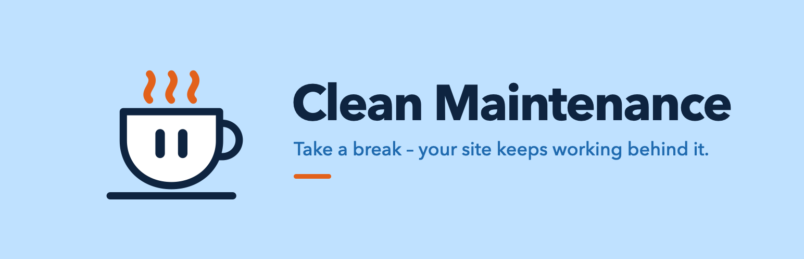
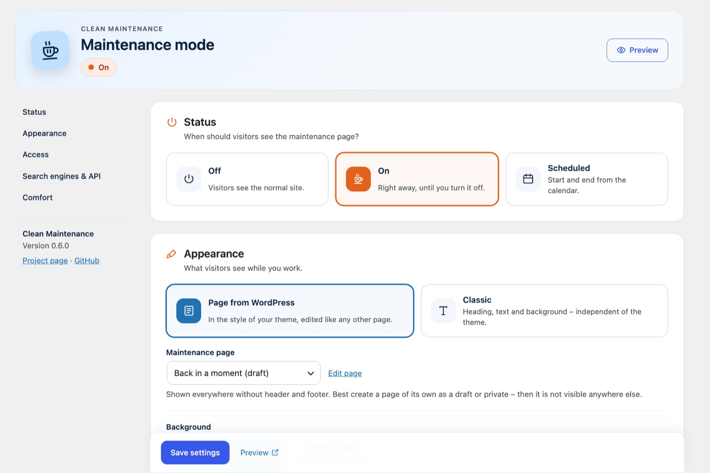
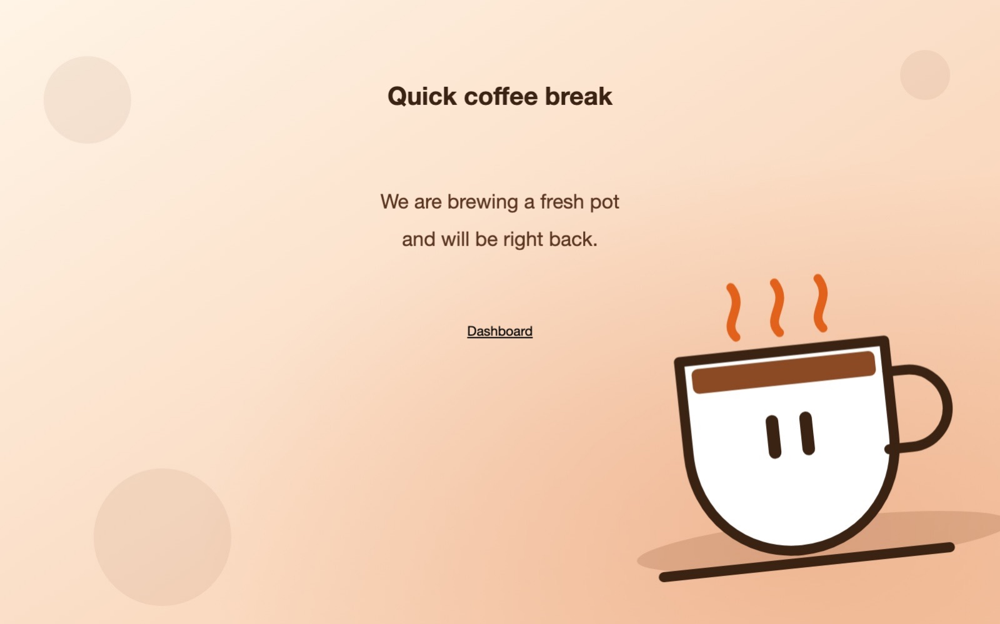
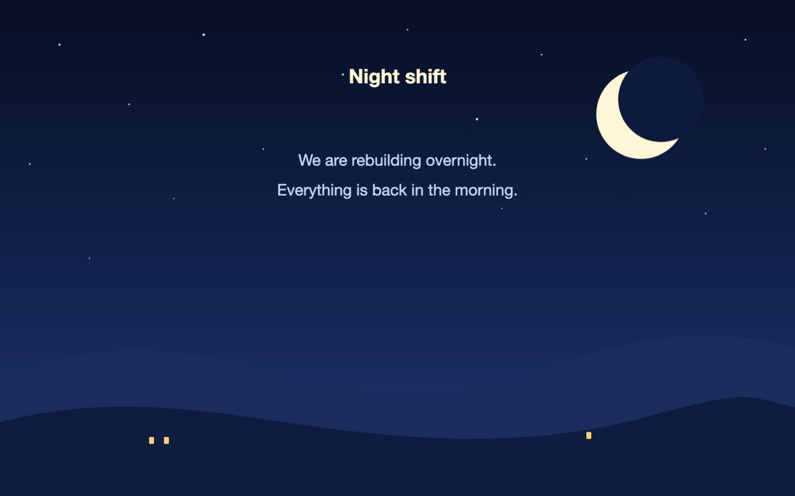
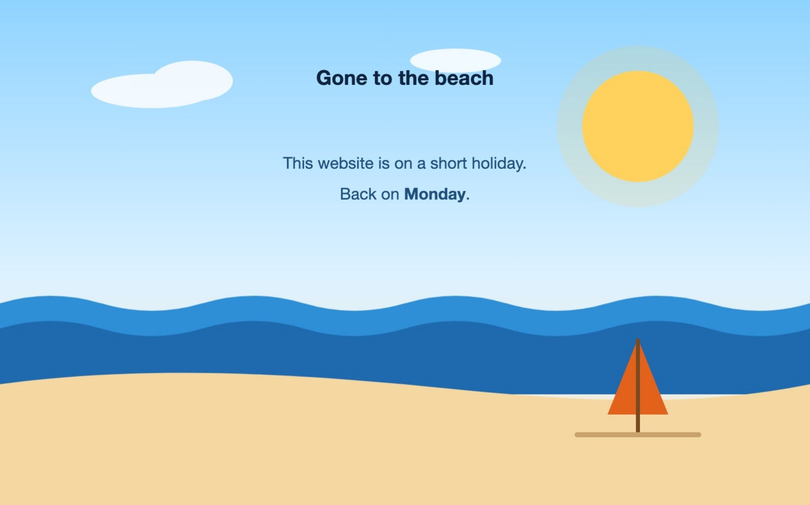
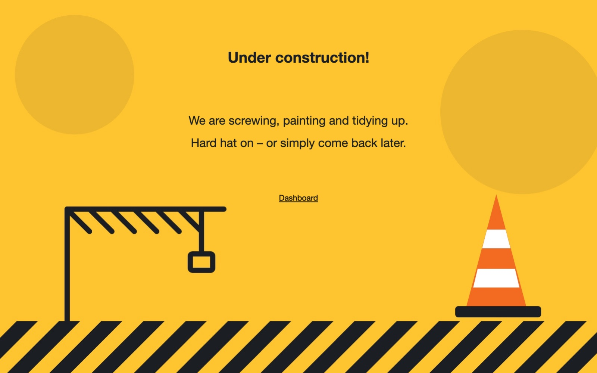
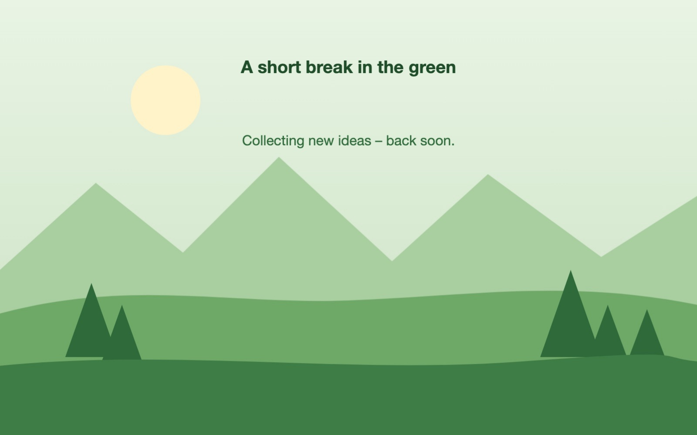
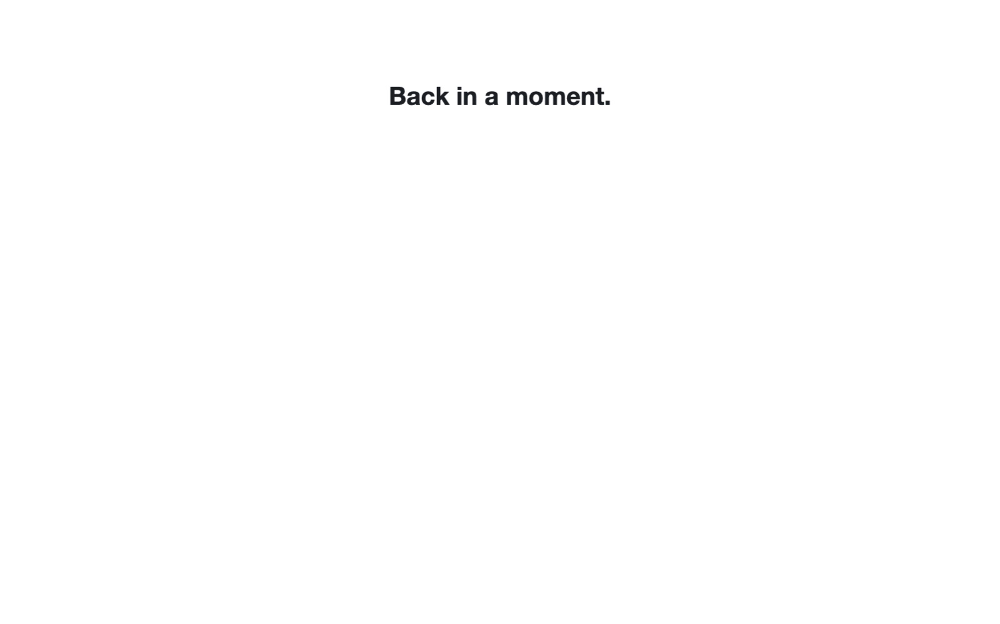
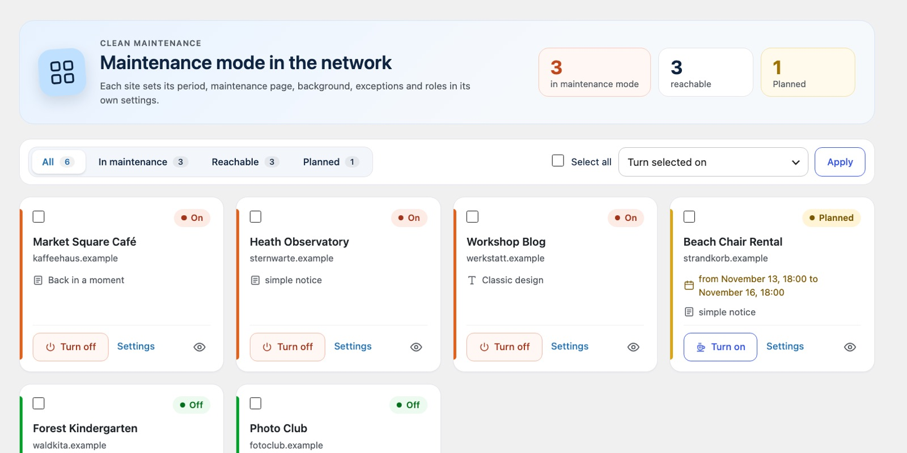
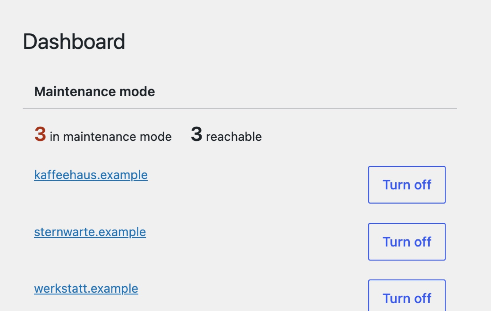

# Clean Maintenance



A lean maintenance mode for WordPress – for a single site or a whole multisite network.

[](https://github.com/matthiasnattke/clean-maintenance/actions/workflows/ci.yml)

Clean Maintenance shows visitors a calm maintenance page while you and everyone with the right role keep working on the site as usual. Search engines get HTTP status `503` with a `Retry-After` header and treat the break as temporary. In a multisite network every site has its own maintenance mode, and the network admin keeps an eye on all of them.

It does one thing and stays out of your way: no page builder, no contact forms, no tracking, no upsell.

I built it for my own WordPress network around the [Couch Blog](https://couch-blog.de). More about the background on the **[project page](https://couch-blog.de/projekte/clean-maintenance/)**.

> **Status:** pre-release (0.x). The plugin runs on my own sites; the submission to the WordPress.org plugin directory is being prepared.

### New in 0.6

- **Settings, ordered by task** – status, appearance, access, search engines & API and comfort, each on its own card. Mode and design are big tiles, options are switches, roles are chips, and a header shows the current state with a preview button.
- **Network overview as cards** – key figures at the top, a filter for paused, reachable and planned sites, and one card per site with its state, planned period, what it shows and a quick switch. Bulk actions stay.
- **A friendlier dashboard widget** – key figures plus the paused and planned sites, each with a switch.

## Screenshots

<p>

</p>

Six example maintenance pages, all made with the classic design – your own background image, colours for heading and text, optionally a link to the dashboard, or just one sentence:

| | | |
|---|---|---|
|  |  |  |
|  |  |  |

In a multisite network, the overview and a dashboard widget keep every site in view:

<p>

</p>
<p>

</p>

The backgrounds in these examples are drawn for this documentation; the sites are fictional.

## Features

| | |
|---|---|
| **Mode** | Off, on, or scheduled with start and end from a calendar (in the site's time zone) |
| **Your own page** | Any WordPress page – even a draft or private – shown in the style of your theme, without header and footer, with background image and colour |
| **Classic design** | A simple standalone page with heading, text and background, independent of the theme |
| **Exceptions** | One slug or IP address per line, comments with `#`. Dashboard, login and `robots.txt` always stay reachable |
| **Roles** | Who still sees the site and who may use the dashboard; everyone else is redirected. Network administrators can never lock themselves out |
| **REST API lock** | Lock the REST API for visitors who are not logged in – always or only during maintenance – with namespaces that stay public (e.g. `oembed`) |
| **Search engines** | HTTP 503 with `Retry-After`, optionally let bots through or send `noindex` |
| **Comfort** | Red "Maintenance mode active" notice in the admin bar with a switch to turn it off, preview with `?cm-preview=1` |
| **Clear settings** | One page, ordered by task – status, appearance, access, search engines and comfort – with tiles, switches and a live status |
| **Multisite** | Overview with key figures, a state filter and one card per site; switch one or many at once; widget in the network dashboard |
| **Languages** | English, German – [help translate](CONTRIBUTING.md#translations) |

Clean Maintenance does not collect or send any personal data, contacts no external services and sets no cookies.

## Installation

1. Download the latest ZIP from [Releases](https://github.com/matthiasnattke/clean-maintenance/releases).
2. In WordPress go to **Plugins → Add New → Upload Plugin**, install and activate it. In a multisite network preferably **network-wide**.
3. Open **Settings → Maintenance mode**, choose your maintenance page and turn the mode on.

Requirements: WordPress 6.4 or later, PHP 8.0 or later.

## Settings

Every site has its own settings under **Settings → Maintenance mode**:

- **Mode** – off, on or scheduled. Without a start the mode applies right away, without an end until you turn it off.
- **Design** – "Page from WordPress" or "Classic".
- **Maintenance page** – best create a page of its own as a draft or private; then it is not visible anywhere else.
- **Background** – image from the media library and/or colour.
- **Exceptions** – e.g. `feed`, `wp-login`, a single page like `imprint`, or your own IP address.
- **Roles with access to the site / to the dashboard**, **Redirect**.
- **Search engine bots**, **Robots meta tag**.
- **REST API for visitors** – *open*, *locked during maintenance* (default) or *always locked*. Locked requests without login get `401`. Logged-in users, the block editor and Jetpack keep working; the REST API hints in the page head are removed.
- **Notice** in the admin bar.

In a multisite network, **Network Admin → Settings → Maintenance mode** shows every site as a card with state, period and what it shows. Filter by paused, reachable or planned, switch a site with one click or select several and switch them together. The widget in the network dashboard shows the key figures and the paused and planned sites.

## For developers

- Action `clean_maintenance_render` – fires right before the maintenance page is printed, e.g. to hide your own bars.
- Filter `clean_maintenance_site_name` – the name on the simple default notice.
- Settings per site live in the option `clean_maintenance`; defaults in `clean_maintenance_defaults()`.

```
clean-maintenance.php     plugin header, loads the parts
includes/core.php         settings, state, scheduling, translations
includes/frontend.php     maintenance page, exceptions, admin bar, REST API lock
includes/admin.php        settings page per site
includes/network.php      network overview and dashboard widget (multisite only)
assets/admin.js           settings page script
languages/                translation template and translations
uninstall.php             removes the settings when the plugin is deleted
tests/                    tests without dependencies: php tests/run.php
tools/                    translations (i18n.js) and version numbers (version.sh)
```

## Contributing

Bug reports, ideas, pull requests and translations are welcome – see [CONTRIBUTING.md](CONTRIBUTING.md).

## Changelog

See [readme.txt](readme.txt).

## Author

**Matthias Nattke** – [couch-blog.de](https://couch-blog.de)

## License

[GPL-2.0-or-later](LICENSE), like WordPress itself.
